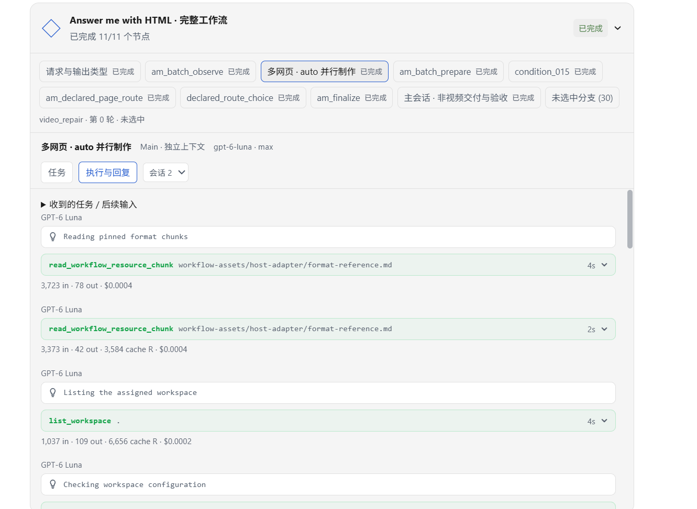

# Answer me with HTML for Pi

[中文](answer-me-with-html-pi.zh-CN.md) · [Download Pi package](../pi/answer-me-with-html/answer-me-with-html.pi-caw.json) · [Compare the three pages](https://tohman233.github.io/workflow-package/workflow_explanations/gallery/#batch?lang=en)

The Pi edition of Answer me with HTML runs in [pi-CAW](https://github.com/TohmaN233/pi-CAW). It carries the upstream v0.5.3 renderer, references and Host adapters in one installable package: **1.0.0**, with **41 nodes and 141 resources**. It is adapted from the Codex Workflow converted from [QingYunA/answer-me-with-html](https://github.com/QingYunA/answer-me-with-html); retain the [original MIT notice](../pi/answer-me-with-html/UPSTREAM-LICENSE.txt).

The initiating conversation handles orchestration and semantic acceptance. Production Main workers use isolated contexts and can produce independent pages in parallel. Host tools prepare inputs, run the existing renderer and collect the results. HTML, video, supplied narration reuse, text rewriting, configuration, cleanup and update routes remain in the graph.

## Install

1. Use a pi-CAW host with the capabilities verified in **local build 0.5.10**, Node.js **22.19+** and a compatible Pi SDK. That engine build is not yet published: the public repository currently reports 0.3.1, which is not qualified for this package. If the receiving host only has that public build, report the missing compatible engine before attempting a Run. See the engine's [installation instructions](https://github.com/TohmaN233/pi-CAW#installation).
2. Download the Pi JSON above and import it through pi-CAW's **Install Workflow** operation. [pi/catalog.json](../pi/catalog.json) records its exact revision, dependencies and file digest. The bundle includes the renderer; a separate original Skill installation is unnecessary.
3. Main inherits the initiating Pi chat's model and thinking level. Configure any explicit child-model slots in the Workflow's **Models** tab and resolve selected-route dependencies on the receiving host.
4. For ordinary HTML, the engine's Node installation is sufficient. Movie export additionally needs Chrome-compatible browser support; MP4 also needs FFmpeg. Narration requires the receiving host's configured TTS. Importing this package makes no speech request.

Do not substitute the Codex engine's MCP commands for the Pi installation interface. See [platform setup](platforms.md) and [shared dependency notes](install.md).

## Workflow visualization in a pi-web frontend

In the author's own frontend, built on pi-web, pi-CAW is integrated with full Workflow visualization. The view below shows node completion, the selected parallel production node, independent worker sessions, and their tool calls and replies. The screenshot documents that frontend integration; other Pi hosts may present the same Workflow differently.

## Produced pages

The gallery includes the supplied Pi outputs for [TCP](examples/html/tcp-pi.html), [Redis / Memcached](examples/html/cache-pi.html) and [Git merge / rebase](examples/html/git-pi.html), alongside the original Skill and Codex Workflow outputs. All three Pi HTML files are copied unchanged. This is an output comparison from a separate run; no Pi token, cost or time comparison is included.
